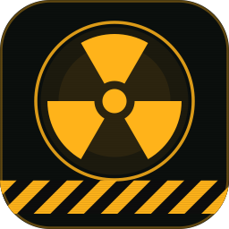
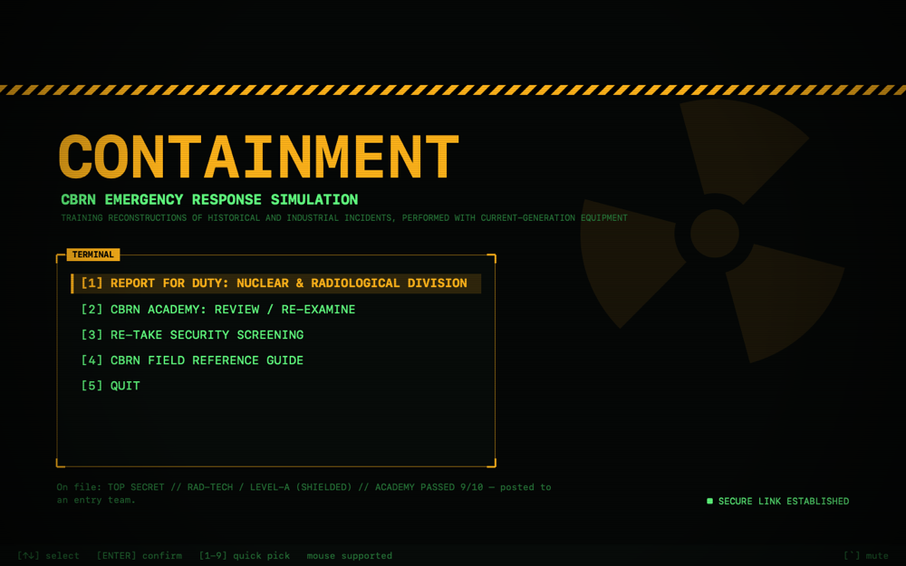
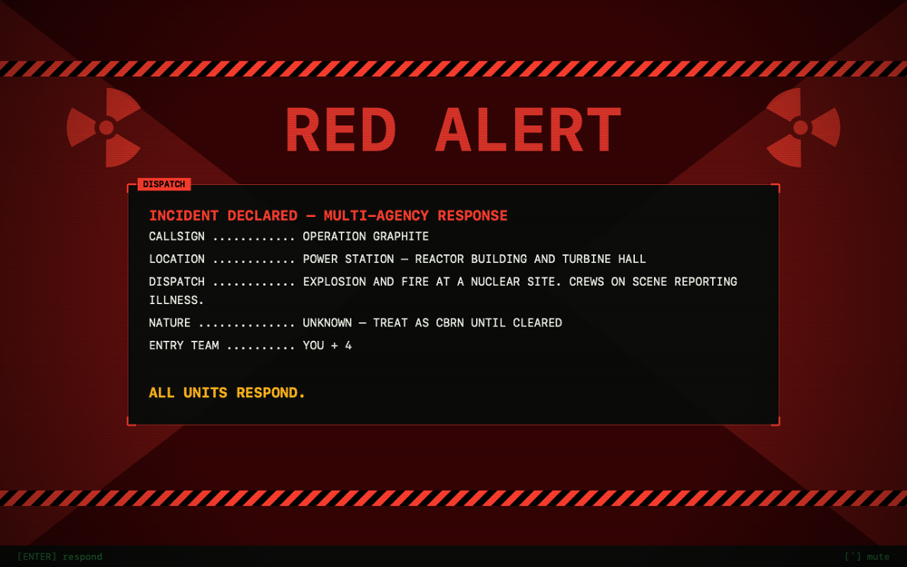
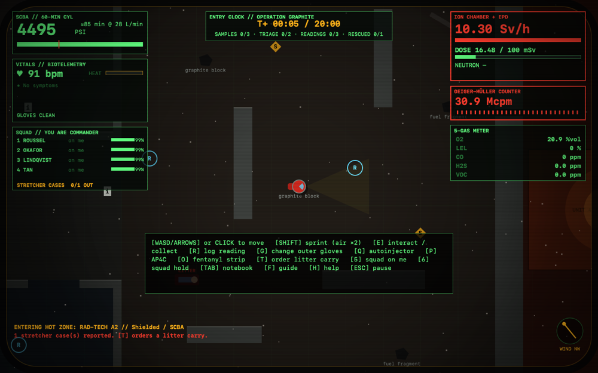
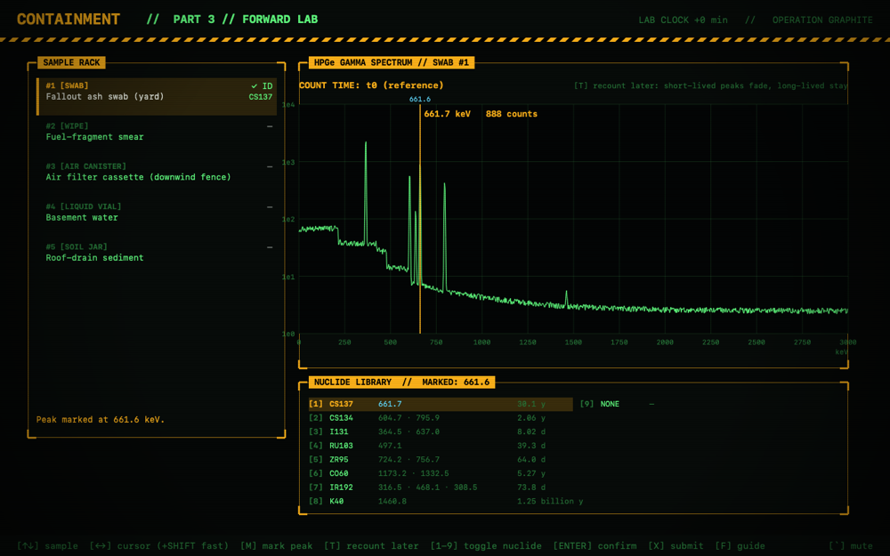
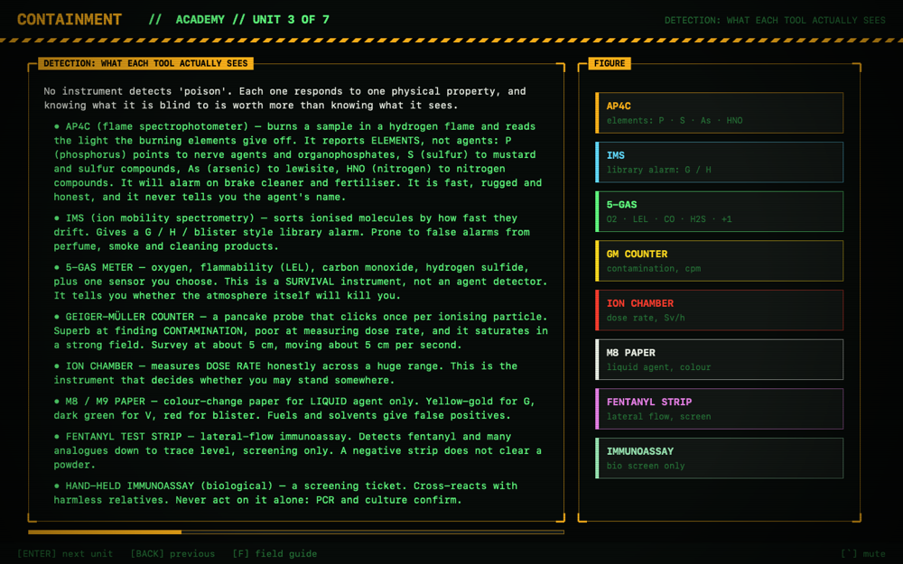
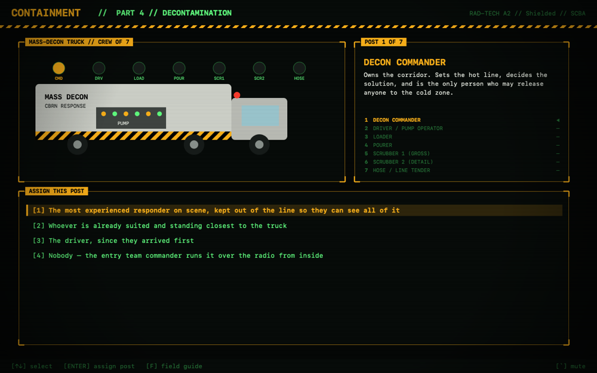

<p align="center">
  
</p>

# CONTAINMENT

A tactical CBRN (chemical, biological, radiological, nuclear) emergency-response simulation for macOS. Native Swift + AppKit/Core Graphics — no game engine, no image or sound assets, all audio synthesized at runtime and the app icon drawn in code.

You take a security clearance screening, pass an academy, and then get called out to incidents you are told nothing about until the alarm sounds. You command a four-person entry team, read real instruments, identify the agent in a forward laboratory, and decontaminate without poisoning yourself on the way out.

> **This is a game, not operational guidance.** Scenarios are simplified, compressed reconstructions of public historical events and composite industrial accidents. The reference content is limited to published, defensive responder knowledge — what detectors show, what a patient looks like, what the countermeasure is, how to decontaminate. Nothing here describes producing or deploying anything.

**Measured footprint: ~44 MB resident after playing all 20 mission variants in one process; ~100 MB live with the window open.** Target was under 300–500 MB on an 8 GB Mac.

---

## Screenshots

| | |
|---|---|
|  |  |
| *Terminal* | *You are told nothing until the alarm sounds* |
|  |  |
| *Hot zone: visor HUD, squad, live telemetry* | *HPGe gamma spectroscopy — real photopeaks and decay* |
|  |  |
| *Academy: what each instrument is blind to* | *Crewing the seven posts on a mass-decon truck* |

---

## Build & run

Requires macOS 12+ and the Xcode command line tools (`xcode-select --install`). Nothing else — no Xcode project, no packages.

```bash
cd ~/Documents/Claude-Projects/containment && ./build.sh && ./build/containment
```

To build a double-clickable app bundle instead:

```bash
cd ~/Documents/Claude-Projects/containment && ./build.sh --app && open build/Containment.app
```

If `build.sh` isn't executable yet:

```bash
chmod +x ~/Documents/Claude-Projects/containment/build.sh
```

To verify everything works (plays all 13 mission variants headless, checks grading and memory):

```bash
cd ~/Documents/Claude-Projects/containment && ./build/containment --selftest
```

To render every screen to PNGs without opening a window:

```bash
cd ~/Documents/Claude-Projects/containment && ./build/containment --shots ./shots
```

---

## Controls

| Key | Action |
|---|---|
| `WASD` / arrows | Move |
| **Click** | Walk there — routes around walls and through doors |
| `Shift` | Sprint — roughly doubles breathing rate and air burn |
| `E` / `Enter` | Interact, collect sample, read intel, exit |
| `R` | Log an instrument reading at your position |
| `G` | Change outer gloves (prevents cross-contaminating the next sample) |
| `Q` | Autoinjector (chem/bio track) |
| `P` | AP4C flame spectrophotometer — sample the air |
| `O` | Fentanyl test strip |
| `T` | Order a litter carry on the casualty in reach |
| `5` / `6` | Squad on me / squad hold position |
| `Tab` | Field notebook — samples, readings, intel |
| `F` | CBRN Field Reference Guide (works in every scene) |
| `H` | Help overlay |
| `` ` `` | Mute |
| `Esc` | Pause / back |

Mouse works everywhere too.

---

## Phase 0 — Clearance screening

Twenty-two items mixing genuine SF-86 counterintelligence questions, real US visa questions reproduced word for word (genocide, terrorist activities, "unlawful commercialized vice", the Communist Party item that has survived since the 1950s), a multi-select travel-history question, and psychological items no one should be asked. Score ≥ 70 routes you to **TOP SECRET // Nuclear & Radiological**; below that, **CONFIDENTIAL // Chemical & Biological**.

## Phase 0b — The Academy (you are not on a team until you pass)

Clearance decides what you are allowed to see. It does not decide whether you are any use at an incident. Seven units with diagrams — agent classification, detection tools, protection levels, entry procedure, casualty handling and search & rescue, decontamination — then a ten-item practical exam. **Pass mark 7/10. Nobody deploys without the badge.** The exam items are the ones that get people hurt: a dry casualty with pinpoint pupils, an AP4C P-band alarm, a filter in an 18.2% oxygen basement, STB on the wrong thing, doffing order.

Pass and you are posted as **entry team commander with a four-person squad**.

## The callout

You do not get to read the file before you go. The duty roster shows a callsign and `[ SEALED ]` — incident type, location, agent, cause and casualties are all withheld. Accept a callout and the **red alert** sounds: klaxon, beacon wash, and a dispatch message that gives you a location and "NATURE: UNKNOWN — TREAT AS CBRN UNTIL CLEARED". Everything else you work out from the radio traffic and your instruments, like everyone else does.

Every incident is framed as present day. Several are reconstructions of real events; the after-action report is where you find out which one you just worked.

---

## The four-part mission loop

1. **Intelligence briefing** — fragmented radio traffic, witness reports, wind telemetry. You classify the incident *before* you know anything: terrorism, military, accident, criminal, or false alarm. This sets your entry window (20–60 simulated minutes).
2. **Hot zone** — top-down tactical field with a live visor HUD. Navigate hazards, take readings, triage casualties, collect sealed samples before air, dose or heat run out.
3. **Forward lab** — gamma spectroscopy (Nuclear/Rad) or wet chemistry, microscopy and PCR (Chem/Bio). Identify the agent, re-classify the incident, recommend a response protocol.
4. **Decon & after-action** — four-station corridor plus suit doffing in the correct order, then a graded report and the real history behind the scenario.

---

## Missions

**Nuclear & Radiological** — 1986 Pripyat Exclusion Zone · 1987 Goiânia orphaned source · 1999 Tokaimura criticality · Port radiological alert (3 variants: NORM false alarm / undeclared radiography source / dispersal device)

**Chemical & Biological** — Ballistic missile alert on a residential street · Underground station mass casualty · Postal & office spores · Rail yard / refinery release (3 variants: chlorine derailment / benzene corrosion / sabotage) · **The Nicotine Level** · **Shopping centre release** (3 variants) · **Arena aerosol alarm** (2 variants)

Twenty variants. Seven of them turn out to be nothing like the first report — including two that are nothing at all.

### Operation Atrium — the shopping centre

Dozens collapsing in an enclosed food court, a crowd crush in progress, and a bag taped into the air handler. Three variants: a deliberate opioid aerosol fed into the building's own ventilation; a clandestine drug kit that vented by accident; and a gym bag with a leaking protein shaker, where every single casualty is crush injury and panic.

The casualties sort it out for you if you read them. Pinpoint pupils and respiratory failure, but **dry** — no drooling, no streaming nose, no sweating, no twitching — is opioid, and gets naloxone and ventilation, not atropine and an oxime. The teenager hyperventilating with normal pupils and 99% saturation is frightened, not poisoned, and an autoinjector would turn her into a real patient. Decon is confined-space: no room for the truck.

### Operation Turnstile — the arena

An environmental biodetector alarms on a bacterial channel with 14,000 people inside and nobody ill. There is a drone on the roof with a spray boom pointed at the air intake. Two variants: a tampered drone with its serial plate ground off and *Bacillus anthracis* in the tank, or the groundskeeper's *Bacillus thuringiensis* biopesticide drone parked upwind to charge.

Hand-held immunoassays cross-react between the two. Only the PCR virulence-plasmid targets — pXO1 and pXO2 — separate them, and the whole mission is about not announcing an agent before the laboratory has one.

### The Nicotine Level

A warehouse bottling vape e-liquid. The 911 caller screams "nerve gas" — everyone inside is vomiting, drooling, sweating and shaking, and there's an agricultural pesticide store next door. The cholinergic picture is real, but it's wrong.

The tells, all in the game:

- **Pulse and blood pressure.** Nicotine's early phase is *fast* pulse and *high* blood pressure. Nerve agent gives you bradycardia and secretions.
- **Pupils.** Normal to slightly wide, not pinpoint.
- **Enzyme ticket stays blue.** Nicotine is a nicotinic receptor agonist, not a cholinesterase inhibitor — so the ChE ticket reads NORMAL where sarin or a pesticide would read INHIBITED.
- **Dragendorff reagent goes orange-red.** It's an alkaloid.
- **pH is alkaline (~9–10).** GC-MS confirms the pyridine alkaloid.
- **Atropine + pralidoxime is the wrong answer.** Pralidoxime does nothing when cholinesterase was never inhibited. Atropine is only for symptomatic bradycardia or heavy secretions. The second casualty shows the late phase — pulse 44, hypotension, weakness — and needs ventilation support, not an oxime.
- **Decon is soap and water.** Nicotine is water-soluble and absorbs through skin; the liquid keeps poisoning the patient until it's washed off. Bleach adds hazard for nothing.

Inject atropine at yourself without indication and you get atropine toxicity — hot, dry, flushed, tachycardic, blocked sweating, and accelerated heat stress inside the suit. The game penalizes it.

---

## Equipment modelled

**Respirators** — assigned protection factors per OSHA 29 CFR 1910.134: pressure-demand SCBA 10,000, tight-fitting full-face PAPR 1,000, full-face APR 50. CBRN canisters have finite service life that shortens at high challenge concentration. Air-purifying respirators are modelled as *failing*: use one below 19.5 % O₂ and you take hypoxia; use one where there's CO and the canister doesn't touch it; use one above IDLH and protection collapses. Each of these ends the mission with a forced extraction and a logged incident.

**Suits** — Level A vapor-protective encapsulating, Level B splash + SCBA, Level C splash + PAPR/APR, anti-C coveralls, MOPP-4 JSLIST with activated-carbon liner, and a shielded RAD-TECH variant with tungsten-polymer panels and a borated liner. Shielding is honest: the shielded suit stops beta and low-energy photons well (Am-241, Tc-99m), does much less against Cs-137 at 662 keV, almost nothing against Co-60 at 1.17/1.33 MeV, and essentially nothing against fast neutrons. Time, distance and concrete are your real protection, and the Tokaimura mission is built around that.

**SCBA cylinders** — 30/45/60-minute ratings on the NIOSH 40 L/min basis, with realistic divergence: suit weight, exertion, heat and sprinting drive consumption, and the low-air alarm sounds at 33 % remaining per NFPA 1981. Sprint through a mission and a 60-minute cylinder won't last 25.

**5-gas meter** — O₂, LEL, CO, H₂S plus a swappable fifth sensor you choose before deployment: PID 10.6 eV, Cl₂, NH₃ or HCN. Picking wrong leaves you blind. A 10.6 eV PID can't see chlorine (ionization energy 11.5 eV), so on the chlorine derailment you need the Cl₂ cell. Chlorine also drives the H₂S reading negative, which is a real electrochemical cross-sensitivity and visible on the meter.

**AP4C flame spectrophotometer** — the Proengin-style field detector, modelled honestly: it burns the sample in a hydrogen flame and reports **elements, not agents**. P lights for nerve agents *and* organophosphate pesticides. S lights for mustard. As for lewisite. HNO for nitrogen compounds — including explosive residue and, in the game as in life, smoke and fuel vapour as interferents. It narrows the field in seconds and it never tells you the agent's name. The HUD shows four band meters and the line "ELEMENT ONLY — NOT AN AGENT ID".

**Geiger-Müller counter** — its own instrument on the radiological track, separate from the ion chamber, with a live click train that tracks the count rate: the GM pancake probe finds *contamination* in cpm, the ion chamber measures *dose rate* in Sv/h. The academy exam asks you which one answers which question.

**Fentanyl test strip** — lateral-flow immunoassay you can run on residue or powder in the field. Screening only: the game says so when it comes back negative, because a negative strip does not clear a powder.

**Other** — electronic personal dosimeter, alpha/beta frisker, neutron REM meter, IMS chemical-agent detector, M8/M9 paper, DuoDote/ATNAA, midazolam, naloxone, RSDL, bio swab kit, HPGe spectrometer, GC-MS, Dragendorff reagent, Gram and spore stains, real-time PCR.

## Your squad

You are the commander. Four responders — Roussel, Okafor, Lindqvist, Tan — enter with you, hold formation, and breathe the same atmosphere you do: they accumulate their own dose, their own agent exposure, and their own air consumption, and they can go down in the hot zone and become your problem.

**Search and rescue**: casualties marked `LITTER` cannot walk out. Order a carry and the two nearest free squad members route to the casualty, lift, and carry them on a stretcher to the decon line while you keep working. A litter takes **two people**, so with four squad you can run two carries at once — and if you have already committed both pairs, the game tells you there are not enough free hands. Squad movement uses a real grid path search, so they find their own way through doors; clicking to move routes you the same way.

Leaving a stretcher case inside when you withdraw is graded as a partial mission failure, and it says so by name in the after-action report.

**Decontamination** — first you crew it, then you run it.

A **mass-decon truck is worked by seven people** and you assign every post: decon commander (kept out of the line so they can see all of it), driver/pump operator (upwind and uphill, then stays on the panel), loader (mixes to the ordered concentration — stronger is not safer, and acid into hypochlorite makes chlorine gas inside your own corridor), pourer (head to toe, away from the facepiece inlet), two scrubbers (soft brush downward; seams, cuffs, welts and under the harness, which is where contamination actually hides), and the hose/line tender (who also calls the stop nobody else is positioned to call). Each wrong post is explained and costs you.

Some incidents have **no room for the truck** — the subway platform, the shopping centre plant room. Those run on a **one-operator 15-litre backpack sprayer** with an improvised berm: same doctrine, a fiftieth of the water, everything leaves with you in a bag.

Then four stations where the solution has to match the hazard:

- **Super tropical bleach (STB)** — calcium hypochlorite and lime, for *equipment, vehicles and terrain*. Correct on tools and meters after nerve agent; wrong on suit seams and visors, never on skin, and genuinely dangerous on fuel (it's a strong oxidizer).
- **5 % hypochlorite** — PPE and equipment after chemical agent.
- **0.5 % hypochlorite (1:10 bleach)** — spores on surfaces, with contact time.
- **Soap and water / detergent** — radiological particulate, nicotine, hydrocarbons, opioid powder (plus HEPA vacuum; nothing that raises the dust again).
- **Water rinse only** — chlorine, where hypochlorite would release more chlorine.
- **RSDL** — skin spot decon, not a suit wash.

Then verification has to use an instrument that actually responds to the hazard, and suit doffing has to follow the right order for your ensemble. **The facepiece always comes off last.** Break respiratory protection while still contaminated and the game tells you exactly what you just did.

---

## Reference basis

Everything the Field Reference Guide states is public, defensive responder knowledge — what detectors show, what a patient looks like, what the countermeasure is, how to decontaminate. There is nothing about producing or deploying anything.

- OSHA 29 CFR 1910.134 (respiratory protection, APFs) and 1910.120 App. B (PPE levels)
- NFPA 1981 (SCBA, 33 % low-air alarm), NFPA 1990 (2022, which consolidated the 1991/1992/1994 ensemble standards)
- NIOSH CBRN respirator approvals and IDLH values
- CDC CHEMM and REMM (nerve agents, vesicants, radiation emergencies, Prussian blue, KI, DTPA)
- NIOSH/InterAgency Board guidance on responder fentanyl exposure, and naloxone for opioid toxidrome
- US DOT Emergency Response Guidebook (placards, UN numbers, guides 124/130)
- EPA PAG Manual 2017 (emergency worker guidelines: 50 / 100 / 250 mSv)
- FDA labels: Seizalam (midazolam for status epilepticus, 2018), Cyfendus (anthrax PEP vaccine, 2023), Radiogardase (Prussian blue)
- US PRISM guidance (disrobe → dry decon → wet decon)
- Standard nuclear data for gamma energies, emission probabilities and half-lives

Gamma spectra are generated from real photopeak energies and emission probabilities with a Compton continuum, detector resolution that scales with energy, and correct decay between recounts — so on the port mission you can tell Ir-192 (73.8 d) from K-40 (1.25 billion y) by recounting a week later and seeing which peaks shrank.

Historical missions are simplified, compressed reconstructions for play. The after-action screen tells you what actually happened in each case, including that the 1991 Scud warheads were all conventional and that more people died from stress-related heart attacks, mask misuse and unnecessary atropine than from the missiles.

**This is a game, not operational guidance.**

---

## Layout

```
source/   Engine.swift      backbuffer renderer, input, scene manager
          Audio.swift       procedural synth: Geiger, SCBA, wind, alarms, heartbeat
          Model.swift       suits, respirators, cylinders, sensors, save state
          Agents.swift      CBRN reference data + decon doctrine
          Screening.swift   clearance interview
          Academy.swift     training units, diagrams, practical exam
          Squad.swift       the four-person squad, litter carries, S&R
          Missions*.swift   mission definitions and map builders
          *Scene.swift      the four-part loop, menus, guide
build.sh                    compile + icon (add --app for a bundle)
```

The app icon is drawn in code (`--icon`) and built into an `.icns` by the build script — no image assets in the repository at all.

Audio is one `AVAudioSourceNode` synthesizing everything — Geiger clicks as a Poisson process, SCBA demand-valve inhale hiss and exhalation whoosh, wind, rumble, heartbeat, and distinct alarms for the gas meter, the SCBA low-air bell, the dosimeter chirp and the civil-defence siren. Every continuous layer is reset between scenes so nothing leaks across missions.
